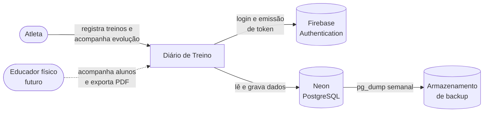
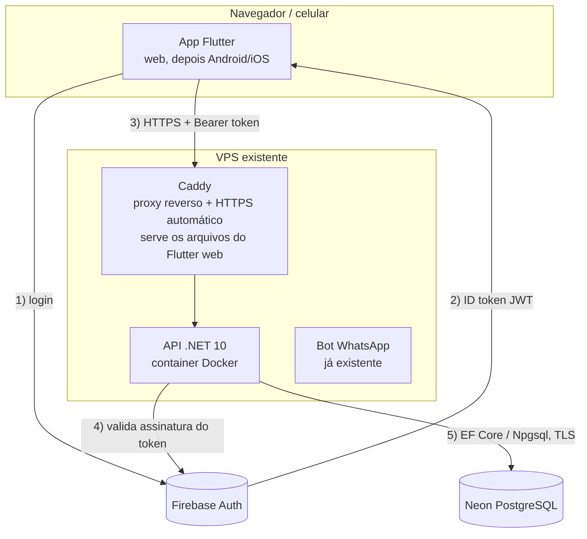
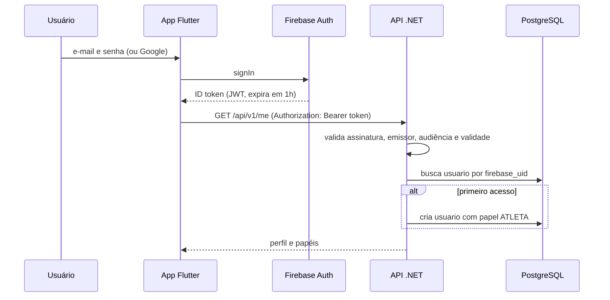
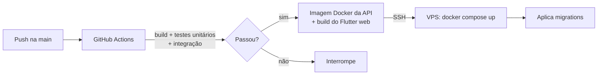

# MAS: Modelo de Arquitetura de Software

**Projeto:** Diário de Treino (nome provisório)
**Versão:** 1.0 (MVP de registro publicado; progresso, tela inicial e catálogo no ar)
**Última atualização:** 14/10/2026
**Documentos relacionados:** [MER.md](MER.md), [BACKLOG.md](BACKLOG.md), [README.md](README.md)

---

## 1. Objetivo do documento

Registrar as decisões de arquitetura do aplicativo, para que qualquer pessoa (ou o Kiro) consiga implementar uma PBI sem reabrir discussões já fechadas. Toda decisão nova ou alterada deve ser refletida aqui.

### 1.1 Estado de implementação (15/10/2026)

O MVP de registro está **publicado e em uso** (Fly + Cloudflare + Neon). Resumo do que a arquitetura já tem no ar vs. o que falta:

**Concluído e na `main`:** fundação back/front (PBI-01/02/03), publicação (PBI-04) com **deploy automático** de API e front no CI (ADR-09), autenticação Firebase + `/me` (PBI-06), controle de acesso centralizado (PBI-07), login/cadastro (PBI-08), catálogo buscar/criar (PBI-10/11) com **carga de 89 exercícios globais**, fichas (PBI-12/13/14), registro de sessão com edição e treino fora da ficha (PBI-15/16/17/18), tela inicial com fichas e rotação (PBI-23), **progresso completo** — gráfico de evolução + observação no ponto + lista de sessões (PBI-20/21/22), design system (temas claro/escuro por tokens), correções de uso real (PBI-32/33) e o épico **Treino ao vivo, série por série** (TV-1 a TV-6: tag de série, faixa de repetições e o fluxo ao vivo com cronômetro, série por série, descanso e resumo). Teste de fluxo via `flutter test` no lugar do E2E Robot (PBI-26 parcial).

**Pendente:** backup do banco (PBI-05), primeiro acesso (PBI-09), treino livre (PBI-19), **tema completo com persistência e opção em Perfil (PBI-24)**, **perfil e conta — ver dados / sair / excluir conta (PBI-25)**, E2E Robot completo (PBI-26), filtro por membro (PBI-31, ADR-10), métrica flexível no registro (PBI-34), cronograma semanal (PBI-35) e todo o incremento 2 de cardio (PBI-27 a PBI-30).

## 2. Visão do produto em uma frase

Aplicativo para registrar treinos (inclusive dias depois do fato) e acompanhar a evolução por exercício, com a observação do dia explicando os pontos fora da curva. Nasce para uso pessoal do atleta, com a estrutura preparada para um educador físico acompanhar os próprios alunos.

## 3. Escopo arquitetural

| Dentro do MVP | Preparado na estrutura, sem tela | Fora (incrementos futuros) |
|---|---|---|
| Login e cadastro | Papel de educador | Telas do modo educador |
| Fichas A/B/C com exercícios | Vínculo educador x aluno | Exportação em PDF |
| Registro da sessão por série, com carga pré-preenchida | Prescrito x executado | Modo corrida por zonas (trechos) |
| Observação do dia | Intensidade e volume genéricos | Importação do relógio/Strava |
| Gráfico de evolução por exercício com filtro de período | | Apps nas lojas (Android/iOS) |

## 4. Requisitos que guiam a arquitetura

### 4.1 Funcionais (macro)

- RF01: o usuário se cadastra e entra com e-mail e senha ou conta Google.
- RF02: o atleta monta fichas (A, B, C...) com exercícios, séries e alvos.
- RF03: o atleta registra uma sessão em qualquer data, com séries pré-preenchidas pela última execução de cada exercício.
- RF04: cada série guarda intensidade (carga, zona, peso corporal) e volume (repetições, tempo, distância).
- RF05: a sessão tem campo de observação livre.
- RF06: o atleta vê a evolução por exercício em gráfico, filtrando 10, 15, 30 dias ou período livre, e abre a observação do dia ao tocar num ponto.
- RF07 (futuro): educador com vínculo ativo vê treino e progresso do aluno e exporta em PDF.

### 4.2 Não funcionais

| Atributo | Requisito | Como a arquitetura atende |
|---|---|---|
| Custo | Até R$ 30/mês, dividido entre os sócios | Banco no plano gratuito do Neon, Firebase Auth gratuito para e-mail e Google, API na VPS já existente |
| Durabilidade | O histórico não pode se perder nunca | Banco gerenciado fora da VPS + `pg_dump` semanal guardado em outro local |
| Segurança | Um usuário nunca vê dado de outro sem vínculo | Regra única de autorização na API, testada |
| Privacidade (LGPD) | Observação pode conter dado de saúde | Acesso só pelo dono e educador vinculado; consentimento antes do modo educador |
| Portabilidade | Web primeiro, lojas depois | Flutter com o mesmo código para web e mobile |
| Manutenibilidade | Dois desenvolvedores em tempo parcial | Monólito em camadas, sem microsserviços, migrations versionadas |
| Disponibilidade | Uso pessoal, sem SLA | Aceita hibernação do banco e reinício da API; sem alta disponibilidade |

## 5. Restrições e premissas

- Back-end em .NET 10 (LTS), front-end em Flutter.
- Banco relacional PostgreSQL; login pelo Firebase Authentication.
- Hospedagem da API na VPS em que já roda o bot de WhatsApp.
- O MVP é usado online. Registro offline não é requisito, porque o fluxo combinado é anotar na academia e alimentar depois.
- Desenvolvimento assistido pelo Kiro; este documento e o MER servem de contexto (steering) para ele.

## 6. Decisões de arquitetura

Cada decisão segue o formato curto de ADR: contexto, decisão e consequência.

### ADR-01: Monólito em camadas, não microsserviços
- **Contexto:** dois desenvolvedores, domínio pequeno, orçamento mínimo.
- **Decisão:** uma única API .NET organizada em camadas (seção 8).
- **Consequência:** um deploy, um banco, depuração simples. Se um módulo crescer muito, as fronteiras das camadas permitem extrair depois.

### ADR-02: PostgreSQL em vez de Firestore
- **Contexto:** o modelo é relacional (vínculos, plano, sessão, séries) e o feedback depende de agregações por período.
- **Decisão:** PostgreSQL acessado via EF Core com o provider Npgsql.
- **Consequência:** consultas de evolução viram SQL simples; migrations versionadas no repositório. Perde-se o acesso direto do app ao banco, que não seria usado de qualquer forma, já que existe API.

### ADR-03: Neon (plano gratuito) como hospedagem do banco
- **Contexto:** volume previsto de poucos MB por ano; VPS barata e compartilhada com o bot.
- **Decisão:** Postgres no Neon, plano gratuito. Backup próprio semanal via `pg_dump`.
- **Consequência:** custo zero e dados fora da VPS. O banco hiberna após 5 minutos sem uso, então a primeira requisição depois de um tempo parado é mais lenta. Aceito para o uso previsto.

### ADR-04: Firebase Authentication para identidade, autorização no nosso banco
- **Contexto:** não queremos guardar senha nem implementar recuperação de conta.
- **Decisão:** o Firebase autentica e emite o token (JWT). A API valida o token e resolve papéis e vínculos no Postgres. Custom claims do Firebase não são usadas para regra de negócio.
- **Consequência:** trocar de provedor de login no futuro afeta só a validação do token. Toda regra de acesso fica num lugar só, testável.

### ADR-05: Prescrito separado do executado
- **Contexto:** o educador vai querer comparar planejado com realizado, e a execução pode fugir do plano.
- **Decisão:** a ficha guarda o prescrito (`treino_exercicio`, `etapa_prescrita`); a sessão guarda o executado (`serie_executada`). O plano apenas pré-preenche a tela.
- **Consequência:** a sessão pode existir sem ficha (treino montado na hora) e alterar o plano nunca altera o histórico.

### ADR-06: Toda série tem intensidade e volume
- **Contexto:** musculação, isometria, corrida e reabilitação medem coisas diferentes.
- **Decisão:** cada série guarda um par (métrica de intensidade, valor) e (métrica de volume, valor), com métricas vindas de uma tabela fixa.
- **Consequência:** um modelo único atende todas as modalidades, e os gráficos conseguem agrupar porque a métrica nunca é texto livre.

### ADR-07: Flutter web primeiro, com semântica habilitada
- **Contexto:** publicar na Apple Store custa caro e só compensa se houver venda; testes E2E serão em Robot Framework.
- **Decisão:** publicar primeiro como web. Habilitar a árvore de semântica do Flutter (`SemanticsBinding.instance.ensureSemantics()`) e dar rótulo a todo campo e botão.
- **Consequência:** o Flutter web desenha em canvas; sem semântica, o Robot não encontra elementos no DOM. Com ela, os testes ficam estáveis e o app ganha acessibilidade de brinde.

### ADR-08: Tema claro e escuro no mesmo app
- **Status:** implementado, com um item em aberto. Design system por tokens no ar; botão sol/lua na Início e **opção tríplice (Sistema/Claro/Escuro) na tela de Perfil** (`TemaController` + `shared_preferences`, padrão `ThemeMode.system`). Falta só a conferência final de contraste 4,5:1 em todas as telas do MVP nos dois temas (**PBI-24**).
- **Contexto:** o cliente aprovou as opções A (clara) e B (escura) e quer as duas.
- **Decisão:** dois temas com a mesma estrutura de telas. Padrão "seguir o sistema" do celular, com troca manual por um botão na tela inicial e uma opção em Perfil (Sistema, Claro, Escuro). A escolha fica salva no aparelho.
- **Consequência:** nenhuma cor é escrita direto nas telas; tudo vem de tokens de tema (`ThemeData` claro e escuro + `ThemeExtension` para cores próprias, como a de observação). Cada componente precisa ser conferido nos dois temas, inclusive o contraste mínimo de texto.

### ADR-09: Hospedagem provisória para a fase de testes
- **Contexto:** para validar o app em uso real sem montar a infraestrutura definitiva, a publicação da PBI-04 foi feita em serviços gerenciados.
- **Decisão:** durante a fase de testes, a API roda no Fly.io (`diario-treino-api.fly.dev`) e o front no Cloudflare (Workers Static Assets, `diario-treino.vitorhugo-an.workers.dev`), com o banco no Neon e login no Firebase. É uma situação **provisória**. A implantação final segue a seção 14: máquina própria com Docker e Caddy, e domínio próprio.
- **Consequência:** nada no código pode depender de recurso exclusivo do Fly ou do Cloudflare. Configuração só por variável de ambiente, API empacotada em Docker e front como arquivos estáticos (`build/web`), para a migração ser só troca de destino do deploy. Na migração: registrar o domínio, atualizar `Cors__OrigensPermitidas`, autorizar o domínio novo no Firebase e apontar o deploy do CI para a máquina.
- **Deploy automático (implementado):** o CI (`.github/workflows/ci.yml`) publica a cada merge na `main`, depois do build + testes: a **API no Fly** (job `deploy-api`, secret `FLY_API_TOKEN`) e o **front no Cloudflare** (job `deploy-web` com `wrangler deploy`, secrets `CLOUDFLARE_API_TOKEN` e `CLOUDFLARE_ACCOUNT_ID`; config em `app/wrangler.toml`). Migrations aplicam no startup da API em produção. Ver `docs/DEPLOY-AUTOMATICO.md`.
- **Histórico — por que saímos do Netlify (15/10/2026):** o front era publicado no Netlify. O plano Free (300 créditos/mês) **pausa os deploys de produção** quando os créditos do ciclo acabam — o site ficou congelado servindo um build antigo, e um release novo não aparecia apesar de mergeado. Migramos para o Cloudflare (Workers Static Assets), que serve o site estático sem esse limite, e o deploy passou a ser feito pelo nosso CI via `wrangler`. Post-mortem completo em `docs/POST-MORTEM-deploy-release2.md`.

### ADR-10: Exercícios classificados por membro, em lista fechada
- **Status:** aceito e **implementado** na PBI-31 (4 etapas). O banco usa `membro_id`/`musculo_id`; o antigo texto livre `grupo_muscular` foi removido na etapa 4.
- **Contexto:** o grupo muscular era texto livre e opcional. Em uso real já apareceram variações ("pernas", "Pernas", "peito" em minúsculo) e exercícios sem grupo. Além disso, o seletor filtrava por modalidade, que não é como a pessoa procura um exercício na hora de registrar: ela pensa "treinei perna", não "fiz força".
- **Decisão:** o exercício passa a ter um **membro** obrigatório, escolhido de uma lista fixa (Peito, Costas, Ombros, Braços, Pernas, Core, Cardio, Mobilidade), e um **músculo** opcional ligado ao membro. Os chips do seletor e do catálogo filtram por membro. A **modalidade continua igual**: segue definindo como o exercício é medido (ADR-06) e aparece na legenda de cada item, só deixa de ser filtro.
- **Consequência:** filtro confiável e base pronta para contar séries por músculo no futuro. Exige migration que converte o texto existente e uma tela de cadastro com seleção em vez de campo livre. A lista final será validada pelo Vinicius; mudanças nela são migrations de seed, sem mudança de código.

## 7. Visão de contexto (C4 nível 1)



## 8. Visão de containers (C4 nível 2)



| Container | Tecnologia | Responsabilidade |
|---|---|---|
| App | Flutter (Dart) | Telas, navegação, estado local, chamadas à API |
| Proxy | Caddy | TLS automático, roteamento por domínio, arquivos estáticos do app web |
| API | ASP.NET Core 10, Minimal APIs | Regras de negócio, autorização, persistência |
| Banco | PostgreSQL (Neon) | Dados do domínio |
| Identidade | Firebase Authentication | Cadastro, login, recuperação de senha, emissão de token |

## 9. Visão lógica do back-end

### 9.1 Estrutura da solução

```
src/
  DiarioTreino.Domain/          entidades, enums, regras puras (sem dependência externa)
  DiarioTreino.Application/     casos de uso, DTOs, interfaces de repositório, validações
  DiarioTreino.Infrastructure/  EF Core, DbContext, migrations, repositórios, integração Firebase
  DiarioTreino.Api/             endpoints, autenticação, middlewares, injeção de dependência
tests/
  DiarioTreino.UnitTests/         xUnit: domínio e casos de uso
  DiarioTreino.IntegrationTests/  xUnit + Testcontainers (Postgres real) + WebApplicationFactory
e2e/
  robot/                          Robot Framework + Browser library contra o app web
```

Regra de dependência: `Api → Application → Domain` e `Infrastructure → Application`. O domínio não conhece EF Core, Firebase nem HTTP.

### 9.2 Módulos de domínio

| Módulo | Entidades | Casos de uso principais |
|---|---|---|
| Identidade | Usuario, UsuarioPapel | Provisionar usuário no primeiro acesso, consultar perfil |
| Vínculos (futuro) | Vinculo | Convidar aluno, aceitar, encerrar |
| Catálogo | Exercicio, Metrica, Membro, Musculo | Listar catálogo global + exercícios próprios com filtro por membro, criar exercício |
| Planejamento | PlanoTreino, Treino, TreinoExercicio, EtapaPrescrita | Montar e editar fichas; criar, renomear, duplicar, definir em uso e excluir plano (PBI-44) |
| Execução | Sessao, SerieExecutada | Abrir sessão pré-preenchida, salvar sessão, editar sessão |
| Progresso | (consultas) | Evolução por exercício, resumo do período, sessões do período |

### 9.3 Bibliotecas de referência

| Necessidade | Escolha |
|---|---|
| ORM | Entity Framework Core + Npgsql |
| Validação de entrada | FluentValidation |
| Logs | Serilog (console estruturado) |
| Documentação da API | OpenAPI nativo do ASP.NET Core |
| Testes | xUnit, Testcontainers, WebApplicationFactory |

## 10. Visão lógica do front-end

```
lib/
  core/          cliente HTTP (Dio), interceptor do token, tema, rotas (go_router)
  features/
    auth/        login, cadastro, perfil (GET /me)
    inicio/      tela inicial, próximo treino, rotação de fichas, botão de tema
    catalogo/    buscar/criar exercício, seletor reaproveitado
    fichas/      montar e editar fichas, definir alvos
    sessao/      registrar/editar/ver/excluir treino
    progresso/   gráfico de evolução, observação no ponto, lista de sessões
  shared/        componentes reutilizáveis
  theme/         tokens de cor e tipografia dos temas claro e escuro
```

| Necessidade | Escolha |
|---|---|
| Estado | Riverpod |
| Navegação | go_router |
| HTTP | Dio, com interceptor que anexa o ID token do Firebase e renova quando expira |
| Login | firebase_auth |
| Gráficos | fl_chart |
| Tema | `ThemeMode` (sistema, claro, escuro) persistido com shared_preferences |
| Escritas e atualização das telas | comandos por funcionalidade (`*_comandos.dart`) e mapa único de invalidação (`core/dados/invalidacao.dart`), PBI-70 |

Organização por funcionalidade (feature-first): cada pasta de `features` tem suas telas, estado e chamadas, o que casa uma PBI com uma pasta.

**Quem muda o dado avisa quem lê (PBI-70).** As telas leem por providers e gravam por comandos (`fichasComandosProvider`, `sessaoComandosProvider`, `catalogoComandosProvider`). O comando chama o repositório, que só faz HTTP, e depois `invalidarDerivados`, o único lugar que invalida providers: plano e ficha atualizam a lista, o plano em uso, o detalhe, a ficha aberta e o rascunho do registro; sessão atualiza também a semana, o histórico e o progresso. Telas não chamam `invalidate`; "Tentar de novo" usa `ref.refresh` da própria leitura. Um teste de arquitetura garante a regra.

No navegador de computador, o conteúdo fica limitado a 600px de largura e centralizado. O app é desenhado para celular e não deve esticar em telas largas.

## 11. Autenticação e autorização

### 11.1 Fluxo



### 11.2 Configuração da validação do token

- Esquema JWT Bearer padrão do ASP.NET Core.
- Authority: `https://securetoken.google.com/<id-do-projeto-firebase>`.
- Emissor válido: o mesmo endereço; audiência válida: o id do projeto.
- Nenhuma chave secreta guardada na API: as chaves públicas do Google são obtidas automaticamente.

### 11.3 Regra única de autorização

Toda leitura ou escrita de dados de um atleta passa por um único serviço:

```
PodeAcessarAtleta(usuarioLogado, atletaId) =
    usuarioLogado.Id == atletaId
    OU existe vinculo(educador = usuarioLogado, aluno = atletaId, status = ATIVO)
```

- Implementado como serviço de aplicação (`IControleAcesso`) chamado pelos casos de uso, nunca reescrito em endpoint.
- Coberto por testes unitários e de integração com os cenários: dono, educador com vínculo ativo, educador com vínculo encerrado, terceiro sem vínculo.
- Escrita de ficha por educador (futuro) exige vínculo ativo e grava o educador como `autor_id` do plano.
- Recurso de outro usuário responde 404, não 403, para não revelar que o recurso existe.
- Plano com autor diferente do atleta é somente leitura para o atleta (PBI-44): escrita responde 403 em Problem Details (`plano-somente-leitura`), sempre **depois** do `IControleAcesso`. Recurso de outro usuário segue 404.

## 12. Contrato da API (v1)

Prefixo `/api/v1`, JSON, datas em ISO 8601, ids em UUID. Erros no formato Problem Details (RFC 9457).

Legenda do status: ✅ implementado e na `main` · ⏳ planejado · 🔵 incremento 2 · 🟣 futuro (modo educador).

| Método | Rota | Descrição | Status |
|---|---|---|---|
| GET | `/health`, `/health/ready` | Liveness e readiness (readiness confere o banco) | ✅ |
| GET | `/me` | Perfil e papéis do usuário logado (provisiona no primeiro acesso) | ✅ |
| DELETE | `/me` | Exclui a conta e os dados do usuário (hard delete transacional) | ✅ |
| GET | `/metricas` | Métricas disponíveis | ✅ |
| GET | `/membros` | Membros e seus músculos, na ordem dos chips | ✅ (PBI-31 etapa 2) |
| GET | `/exercicios?busca=&modalidade=&membro=` | Catálogo global + exercícios do usuário; filtra por membro e/ou modalidade | ✅ |
| POST | `/exercicios` | Cria exercício próprio (exige `membroId`; `musculoId` opcional) | ✅ |
| GET | `/planos` | Planos do atleta (id, nome, início, emUso, autor, somenteLeitura, nº de fichas e de exercícios) | ⏳ PBI-44 |
| GET | `/planos/{id}` | Detalhe do plano com as fichas | ⏳ PBI-44 |
| POST | `/planos` | Com `{ nome }` cria o plano. Sem corpo, mantém o comportamento atual (idempotente) até o E2E fechar | ⏳ PBI-44 |
| PUT | `/planos/{id}` | Renomeia | ⏳ PBI-44 |
| POST | `/planos/{id}/em-uso` | Define como em uso, em transação | ⏳ PBI-44 |
| POST | `/planos/{id}/duplicar` | Cria "Nome (cópia)" fora de uso, sem sessões | ⏳ PBI-44 |
| DELETE | `/planos/{id}` | Exclui (apaga ou esconde, regra 10 do MER) | ⏳ PBI-44 |
| GET | `/planos/ativo` | Alias do plano em uso até o front migrar | ✅ |
| POST | `/planos/{id}/treinos` | Adiciona ficha **ao plano do id da URL** | ✅, corrigido na PBI-44 |
| POST | `/planos/fichas-de-treino` | Cria ficha a partir dos exercícios de um treino livre (grava no plano em uso) | ✅ (PBI-19) |
| GET | `/treinos/{id}` | Detalhe da ficha com exercícios | ✅ |
| PUT | `/treinos/{id}` | Edita ficha (nome) | ✅ |
| DELETE | `/treinos/{id}` | **Apaga** a ficha sem sessões, **arquiva** a com sessões | ✅ |
| POST | `/treinos/{id}/exercicios` | Adiciona exercício à ficha | ✅ |
| PUT | `/treinos/{id}/exercicios/ordem` | Reordena exercícios | ✅ |
| DELETE | `/treinos/{id}/exercicios/{teId}` | Remove exercício da ficha | ✅ |
| PUT | `/treinos/{id}/exercicios/{teId}/alvos` | Define alvos (séries, carga/reps, descanso) | ✅ |
| GET | `/treinos/{id}/rascunho-sessao` | Sessão pré-preenchida com a última execução | ✅ |
| GET | `/exercicios/{id}/ultima-execucao` | Última execução do exercício para o treino livre | ✅ (PBI-19) |
| POST | `/sessoes` | Salva sessão com séries (`treinoId` nulo = treino livre) | ✅ |
| GET | `/sessoes/{id}` | Detalhe da sessão | ✅ |
| PUT | `/sessoes/{id}` | Edita sessão | ✅ |
| DELETE | `/sessoes/{id}` | Exclui sessão | ✅ |
| GET | `/sessoes?de=&ate=` | Sessões do período | ✅ |
| GET | `/progresso/exercicios` | Exercícios com histórico (seletor do gráfico) | ✅ |
| GET | `/progresso/exercicios/{id}?de=&ate=` | Série temporal do exercício, com reps, `sessaoId` e observação por ponto | ✅ |
| GET | `/progresso/resumo?de=&ate=` | Contagem de treinos e sessões de cardio | 🔵 PBI-30 |
| GET | `/alunos` | Alunos com vínculo ativo | 🟣 |
| POST | `/vinculos` | Convida aluno | 🟣 |
| GET | `/alunos/{id}/progresso/pdf?de=&ate=` | Relatório em PDF | 🟣 |

Rotas de dados de atleta aceitam `atletaId` opcional na query para o educador; sem ele, vale o usuário logado. A regra da seção 11.3 é aplicada sempre.

## 13. Dados

- Modelo completo, dicionário de dados e índices: [MER.md](MER.md).
- Migrations do EF Core versionadas no repositório e aplicadas no deploy.
- Banco de desenvolvimento local em Docker; banco de produção no Neon.
- Backup: `pg_dump` semanal automatizado (job agendado na VPS), guardado fora da VPS e do Neon, com teste de restauração a cada trimestre.

## 14. Implantação

> **Fase de testes:** enquanto o app está em validação, a publicação é provisória no Fly.io (API) e no Cloudflare (front, Workers Static Assets), conforme o ADR-09. O desenho abaixo é o da implantação final, em máquina própria com domínio próprio.



- `docker-compose.yml` na VPS com os serviços `caddy` e `api`, separados do compose do bot.
- Configurações sensíveis (string de conexão, id do projeto Firebase) em variáveis de ambiente, nunca no repositório.
- Ambientes: `local` (Docker) e `producao`. Um ambiente de homologação só se surgir necessidade.
- Health check em `/health`, usado pelo Docker para reiniciar a API se ela travar.

## 15. Qualidade e testes

| Nível | Ferramenta | O que cobre |
|---|---|---|
| Unitário | xUnit | Regras de domínio, controle de acesso, cálculo de pré-preenchimento |
| Integração | xUnit + Testcontainers + WebApplicationFactory | Endpoints com Postgres real e token falso assinado localmente |
| E2E | Robot Framework + Browser library | Fluxo principal no app web: entrar, registrar treino, ver no gráfico |
| Front | flutter_test | Widgets críticos (formulário de série, filtro de período) |

Definition of Done mínima de uma PBI: critérios de aceite atendidos, testes do nível adequado passando no CI, migration criada quando houver mudança de banco, este documento atualizado se alguma decisão mudou.

## 16. Segurança e LGPD

- HTTPS obrigatório (Caddy) e conexão TLS com o banco.
- Sem senha armazenada pela aplicação.
- CORS restrito ao domínio do app.
- Logs nunca registram token nem texto de observação.
- Exclusão de conta remove os dados do usuário no banco e no Firebase (PBI-25, implementado). `DELETE /api/v1/me` faz hard delete transacional dos dependentes do usuário (sessões → planos → vínculos → exercícios próprios → papéis → usuário, porque as FKs para `usuario` são `Restrict`); o app então remove o usuário no Firebase (`currentUser.delete()`), pedindo reautenticação se o Firebase exigir login recente.
- Antes do modo educador: termo de consentimento cobrindo acesso do educador às observações e exportação em PDF.

## 17. Observabilidade

- Logs estruturados em console (Serilog), lidos via `docker logs`.
- Identificador de correlação por requisição.
- Endpoint `/health` checando API e conexão com o banco.

## 18. Riscos e pontos em aberto

| Risco ou dúvida | Impacto | Tratamento |
|---|---|---|
| VPS sobrecarregada com bot + API | Lentidão ou queda | Monitorar memória; mover a API se necessário |
| Hibernação do Neon | Primeira requisição lenta | Aceito; reavaliar se incomodar no uso real |
| Mudança nos limites do plano gratuito do Neon | Custo inesperado | Backup próprio permite migrar de provedor |
| Definição de zona (FC, pace ou percepção) | Afeta modelo do modo corrida | Pergunta enviada ao Vinicius |
| Privacidade das observações frente ao educador | Afeta regra de acesso | Decidir antes do modo educador |
| ~~Métrica do gráfico (maior carga ou volume)~~ | ~~Afeta consulta de progresso~~ | **Resolvido (PO, 14/10):** maior carga da sessão + reps daquela série; isometria = maior tempo. Implementado no PBI-20 |

## 19. Evolução prevista

1. Incremento 2: cardio como exercício de modalidade CARDIO (zona x tempo ou distância) e resumo do período.
2. Modo educador: telas de vínculo, visão do aluno, exportação em PDF gerada a partir da mesma consulta do progresso.
3. Modo corrida por zonas: trechos com esforço e recuperação, feedback por tempo em zona.
4. Importação de arquivo do relógio ou Strava.
5. Publicação nas lojas.
