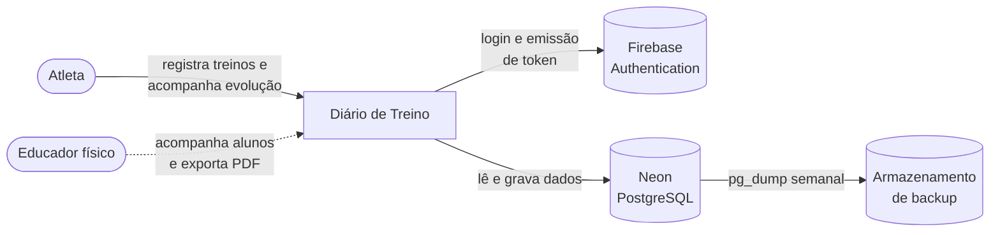
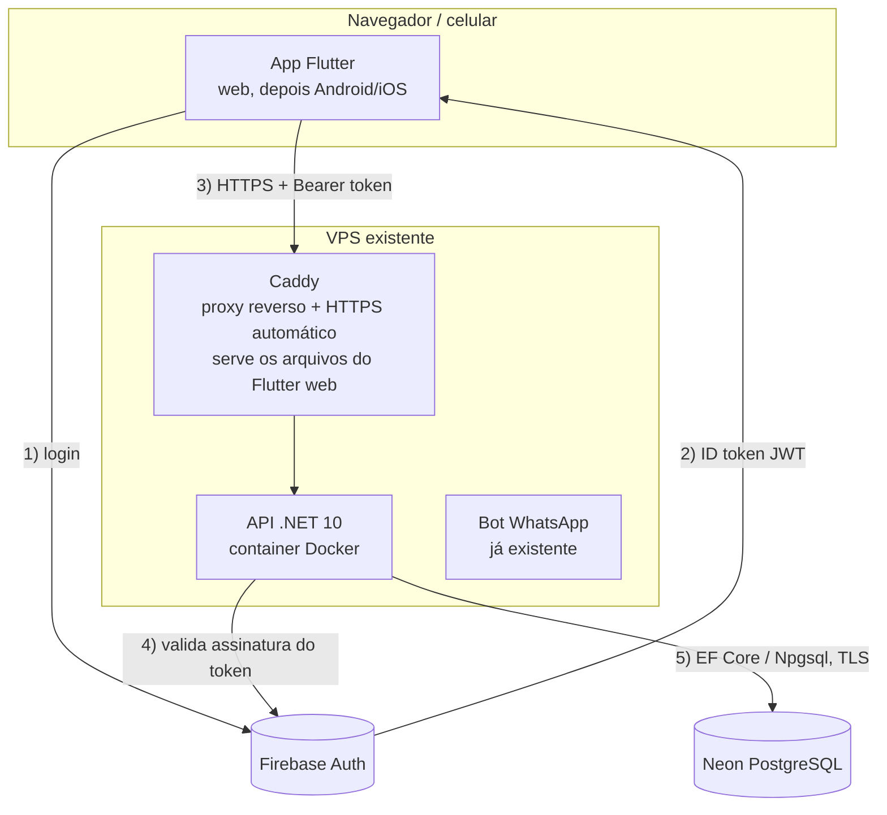
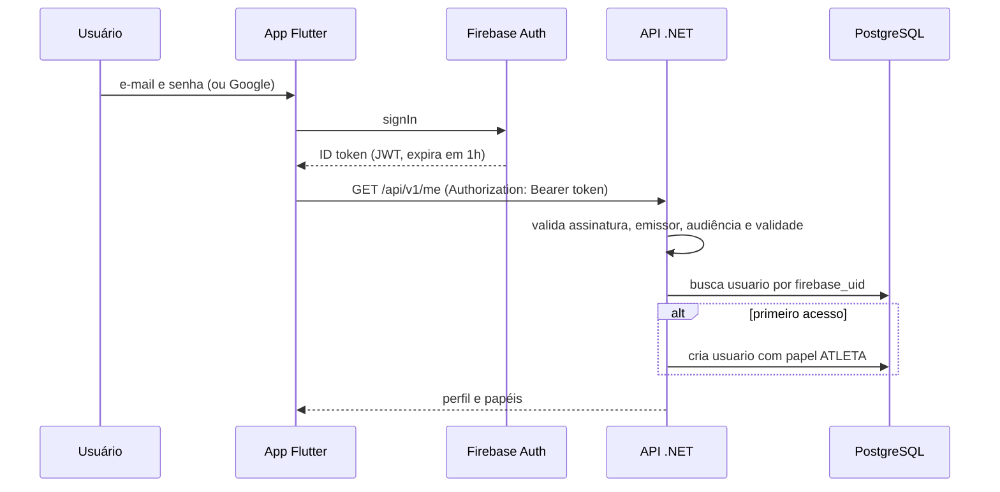
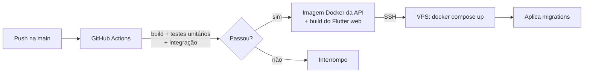

# MAS: Modelo de Arquitetura de Software

**Projeto:** Diário de Treino (nome provisório)
**Versão:** 1.1 (MVP e modo educador publicados)
**Última atualização:** 05/11/2026
**Documentos relacionados:** [MER.md](MER.md), [BACKLOG.md](BACKLOG.md), [README.md](README.md)

---

## 1. Objetivo do documento

Registrar as decisões de arquitetura do aplicativo, para que qualquer pessoa (ou o Kiro) consiga implementar uma PBI sem reabrir discussões já fechadas. Toda decisão nova ou alterada deve ser refletida aqui.

### 1.1 Estado de implementação (13/11/2026)

O MVP de registro está **publicado e em uso** (Fly + Cloudflare + Neon), com deploy automático da API e do front a cada merge na `main` (ADR-09). A última entrega é o ajuste do "X" na faixa da semana (PR #148), depois do épico E13 (exercícios conjugados, PRs #144 a #147).

**Concluído e na `main`:** fundação back/front (PBI-01 a 03), publicação (PBI-04), autenticação Firebase, `/me` e controle de acesso centralizado (PBI-06 a 08), catálogo com 89 exercícios globais, busca, criação e filtro por membro e músculo (PBI-10, 11, 31, 32, 54), fichas (PBI-12 a 14, 36), registro de sessão com edição, exercício fora da ficha e treino livre (PBI-15 a 19), primeiro acesso (PBI-09), tela inicial com semana, último treino e dicas (PBI-23, 59, 60), progresso com gráfico, observação no ponto e lista de sessões (PBI-20 a 22), perfil, tema e exclusão de conta (PBI-25 e 24), **backup semanal do banco (PBI-05)**, treino em andamento (PBI-37), épico **Treino ao vivo, série por série** (TV-1 a TV-6 = PBI-38 a 43), épico **Planos** com vários planos e um em uso (PBI-44 a 47, 49), ajustes de layout (PBI-50 a 55 e 57 a 67), correções e fluxos de entrada (PBI-68 a 72: sem plano, criar plano, Registrar treino, "Manter na ficha?", atualização das telas pela origem da mudança), as correções de uso real de 16 a 19/10 (**PBI-73, 74, 76, 77, 78, 79 e 80**) e o **calendário do mês (PBI-82)**.

Também na `main`: o **modo educador (épico E7, PBI-85 a 89 e PBI-48)** — vínculo com consentimento, telas do educador, plano montado para o aluno e PDF do progresso —, o aviso curto em pílula em todo o app (PBI-75), os ajustes do treino ao vivo (PBI-90) e a **semana planejada do plano (PBI-35)**. No épico E12 (corpo e medidas), as **medidas corporais** (PBI-91 no back e PBI-92 no app) os **dados corporais com a TMB** (PBI-93), o **gráfico de evolução da medida** (PBI-94) e a **TMB informada pelo atleta** (PBI-98). O **campo de data** compartilhado com digitação (PBI-97). A API responde **sem cache** (`Cache-Control: no-store`, PBI-100). E o épico **E13 · Exercícios conjugados**: o bloco na ficha (PBI-101, ADR-12), o treino ao vivo com um "feito" e um descanso por rodada (PBI-102) e o bloco agrupado no detalhe da sessão (PBI-103).

**Pendente:** o compartilhamento do corpo com o educador (PBI-95 e 96, aguardam o PO), trocar a métrica no registro (PBI-34, aguarda decisão do PO), e todo o incremento 2 de cardio (PBI-27 a 30). (Backup PBI-05, contraste PBI-24 e E2E PBI-26 concluídos.)

## 2. Visão do produto em uma frase

Aplicativo para registrar treinos (inclusive dias depois do fato) e acompanhar a evolução por exercício, com a observação do dia explicando os pontos fora da curva. Nasce para uso pessoal do atleta, com a estrutura preparada para um educador físico acompanhar os próprios alunos.

## 3. Escopo arquitetural

| Dentro do MVP | Entregue depois (E7) | Fora (incrementos futuros) |
|---|---|---|
| Login e cadastro | Papel de educador | Telas do modo educador |
| Fichas A/B/C com exercícios | Vínculo educador x aluno | Exportação em PDF |
| Registro da sessão por série, com carga pré-preenchida | Prescrito x executado | Cardio por zonas (incremento 2) |
| Observação do dia | Intensidade e volume genéricos | Importação do relógio/Strava |
| Gráfico de evolução por exercício com filtro de período | | Apps nas lojas (Android/iOS) |

## 4. Requisitos que guiam a arquitetura

### 4.1 Funcionais (macro)

- RF01: o usuário se cadastra e entra com e-mail e senha ou conta Google.
- RF02: o atleta monta fichas (A, B, C...) com exercícios, séries e alvos.
- RF03: o atleta registra uma sessão em qualquer data, com séries pré-preenchidas pela última execução de cada exercício.
- RF04: cada série guarda intensidade (carga, zona, peso corporal) e volume (repetições, tempo, distância).
- RF05: a sessão tem campo de observação livre.
- RF06: o atleta vê a evolução por exercício em gráfico, filtrando 10, 15, 30 dias ou período livre, e abre a observação do dia ao tocar num ponto.
- RF07 (entregue, E7): educador com vínculo ativo vê treino e progresso do aluno e exporta em PDF.

### 4.2 Não funcionais

| Atributo | Requisito | Como a arquitetura atende |
|---|---|---|
| Custo | Até R$ 30/mês, dividido entre os sócios | Banco no plano gratuito do Neon, Firebase Auth gratuito para e-mail e Google, API na VPS já existente |
| Durabilidade | O histórico não pode se perder nunca | Banco gerenciado fora da VPS + `pg_dump` semanal guardado em outro local |
| Segurança | Um usuário nunca vê dado de outro sem vínculo | Regra única de autorização na API, testada |
| Privacidade (LGPD) | Observação pode conter dado de saúde | Acesso só pelo dono e educador vinculado; consentimento antes do modo educador |
| Portabilidade | Web primeiro, lojas depois | Flutter com o mesmo código para web e mobile |
| Manutenibilidade | Dois desenvolvedores em tempo parcial | Monólito em camadas, sem microsserviços, migrations versionadas |
| Disponibilidade | Uso pessoal, sem SLA | Aceita hibernação do banco e reinício da API; sem alta disponibilidade |

## 5. Restrições e premissas

- Back-end em .NET 10 (LTS), front-end em Flutter.
- Banco relacional PostgreSQL; login pelo Firebase Authentication.
- Hospedagem da API na VPS em que já roda o bot de WhatsApp.
- O MVP é usado online. Registro offline não é requisito, porque o fluxo combinado é anotar na academia e alimentar depois.
- Desenvolvimento assistido pelo Kiro; este documento e o MER servem de contexto (steering) para ele.

## 6. Decisões de arquitetura

Cada decisão segue o formato curto de ADR: contexto, decisão e consequência.

### ADR-01: Monólito em camadas, não microsserviços
- **Contexto:** dois desenvolvedores, domínio pequeno, orçamento mínimo.
- **Decisão:** uma única API .NET organizada em camadas (seção 8).
- **Consequência:** um deploy, um banco, depuração simples. Se um módulo crescer muito, as fronteiras das camadas permitem extrair depois.

### ADR-02: PostgreSQL em vez de Firestore
- **Contexto:** o modelo é relacional (vínculos, plano, sessão, séries) e o feedback depende de agregações por período.
- **Decisão:** PostgreSQL acessado via EF Core com o provider Npgsql.
- **Consequência:** consultas de evolução viram SQL simples; migrations versionadas no repositório. Perde-se o acesso direto do app ao banco, que não seria usado de qualquer forma, já que existe API.

### ADR-03: Neon (plano gratuito) como hospedagem do banco
- **Contexto:** volume previsto de poucos MB por ano; VPS barata e compartilhada com o bot.
- **Decisão:** Postgres no Neon, plano gratuito. Backup próprio semanal via `pg_dump`.
- **Consequência:** custo zero e dados fora da VPS. O banco hiberna após 5 minutos sem uso, então a primeira requisição depois de um tempo parado é mais lenta. Aceito para o uso previsto.

### ADR-04: Firebase Authentication para identidade, autorização no nosso banco
- **Contexto:** não queremos guardar senha nem implementar recuperação de conta.
- **Decisão:** o Firebase autentica e emite o token (JWT). A API valida o token e resolve papéis e vínculos no Postgres. Custom claims do Firebase não são usadas para regra de negócio.
- **Consequência:** trocar de provedor de login no futuro afeta só a validação do token. Toda regra de acesso fica num lugar só, testável.

### ADR-05: Prescrito separado do executado
- **Contexto:** o educador vai querer comparar planejado com realizado, e a execução pode fugir do plano.
- **Decisão:** a ficha guarda o prescrito (`treino_exercicio`, `etapa_prescrita`); a sessão guarda o executado (`serie_executada`). O plano apenas pré-preenche a tela.
- **Consequência:** a sessão pode existir sem ficha (treino montado na hora) e alterar o plano nunca altera o histórico.

### ADR-06: Toda série tem intensidade e volume
- **Contexto:** musculação, isometria, corrida e reabilitação medem coisas diferentes.
- **Decisão:** cada série guarda um par (métrica de intensidade, valor) e (métrica de volume, valor), com métricas vindas de uma tabela fixa.
- **Consequência:** um modelo único atende todas as modalidades, e os gráficos conseguem agrupar porque a métrica nunca é texto livre.

### ADR-07: Flutter web primeiro, com semântica habilitada
- **Contexto:** publicar na Apple Store custa caro e só compensa se houver venda.
- **Decisão:** publicar primeiro como web. Habilitar a árvore de semântica do Flutter (`SemanticsBinding.instance.ensureSemantics()`) e dar rótulo a todo campo e botão.
- **Consequência:** o Flutter web desenha em canvas (CanvasKit); a semântica dá acessibilidade e rótulos estáveis. **Atualização (PBI-26):** o E2E de UI *não* é feito por fora (Robot/Playwright pelo DOM) — no CanvasKit os campos de texto não aceitam entrada via DOM de forma confiável. O E2E usa `integration_test`, que dirige a árvore de widgets (`tester.enterText`). Ver PBI-26 no BACKLOG.

### ADR-08: Tema claro e escuro no mesmo app
- **Status:** implementado, com um item em aberto. Design system por tokens no ar; botão sol/lua na Início e **opção tríplice (Sistema/Claro/Escuro) na tela de Perfil** (`TemaController` + `shared_preferences`, padrão `ThemeMode.system`). Falta só a conferência final de contraste 4,5:1 em todas as telas do MVP nos dois temas (**PBI-24**).
- **Contexto:** o cliente aprovou as opções A (clara) e B (escura) e quer as duas.
- **Decisão:** dois temas com a mesma estrutura de telas. Padrão "seguir o sistema" do celular, com troca manual por um botão na tela inicial e uma opção em Perfil (Sistema, Claro, Escuro). A escolha fica salva no aparelho.
- **Consequência:** nenhuma cor é escrita direto nas telas; tudo vem de tokens de tema (`ThemeData` claro e escuro + `ThemeExtension` para cores próprias, como a de observação). Cada componente precisa ser conferido nos dois temas, inclusive o contraste mínimo de texto.

### ADR-09: Hospedagem provisória para a fase de testes
- **Contexto:** para validar o app em uso real sem montar a infraestrutura definitiva, a publicação da PBI-04 foi feita em serviços gerenciados.
- **Decisão:** durante a fase de testes, a API roda no Fly.io (`diario-treino-api.fly.dev`) e o front no Cloudflare (Workers Static Assets, `diario-treino.vitorhugo-an.workers.dev`), com o banco no Neon e login no Firebase. É uma situação **provisória**. A implantação final segue a seção 14: máquina própria com Docker e Caddy, e domínio próprio.
- **Consequência:** nada no código pode depender de recurso exclusivo do Fly ou do Cloudflare. Configuração só por variável de ambiente, API empacotada em Docker e front como arquivos estáticos (`build/web`), para a migração ser só troca de destino do deploy. Na migração: registrar o domínio, atualizar `Cors__OrigensPermitidas`, autorizar o domínio novo no Firebase e apontar o deploy do CI para a máquina.
- **Deploy automático (implementado):** o CI (`.github/workflows/ci.yml`) publica a cada merge na `main`, depois do build + testes: a **API no Fly** (job `deploy-api`, secret `FLY_API_TOKEN`) e o **front no Cloudflare** (job `deploy-web` com `wrangler deploy`, secrets `CLOUDFLARE_API_TOKEN` e `CLOUDFLARE_ACCOUNT_ID`; config em `app/wrangler.toml`). Migrations aplicam no startup da API em produção. Ver `docs/DEPLOY-AUTOMATICO.md`.
- **Histórico — por que saímos do Netlify (15/10/2026):** o front era publicado no Netlify. O plano Free (300 créditos/mês) **pausa os deploys de produção** quando os créditos do ciclo acabam — o site ficou congelado servindo um build antigo, e um release novo não aparecia apesar de mergeado. Migramos para o Cloudflare (Workers Static Assets), que serve o site estático sem esse limite, e o deploy passou a ser feito pelo nosso CI via `wrangler`. Post-mortem completo em `docs/POST-MORTEM-deploy-release2.md`.

### ADR-10: Exercícios classificados por membro, em lista fechada
- **Status:** aceito e **implementado** na PBI-31 (4 etapas). O banco usa `membro_id`/`musculo_id`; o antigo texto livre `grupo_muscular` foi removido na etapa 4.
- **Contexto:** o grupo muscular era texto livre e opcional. Em uso real já apareceram variações ("pernas", "Pernas", "peito" em minúsculo) e exercícios sem grupo. Além disso, o seletor filtrava por modalidade, que não é como a pessoa procura um exercício na hora de registrar: ela pensa "treinei perna", não "fiz força".
- **Decisão:** o exercício passa a ter um **membro** obrigatório, escolhido de uma lista fixa (Peito, Costas, Ombros, Braços, Pernas, Core, Cardio, Mobilidade), e um **músculo** opcional ligado ao membro. Os chips do seletor e do catálogo filtram por membro. A **modalidade continua igual**: segue definindo como o exercício é medido (ADR-06) e aparece na legenda de cada item, só deixa de ser filtro.
- **Consequência:** filtro confiável e base pronta para contar séries por músculo no futuro. Exige migration que converte o texto existente e uma tela de cadastro com seleção em vez de campo livre. A lista final será validada pelo Vinicius; mudanças nela são migrations de seed, sem mudança de código.

### ADR-11: Tocar numa aba abre a raiz dela
- **Status:** implementado (PBI-80).
- **Contexto:** o `StatefulShellRoute` guarda a pilha de cada aba. Com `initialLocation` verdadeiro só na aba atual, quem abria uma ficha, ia para a Início e voltava a Planos caía na ficha, não na lista de planos. Relato do Vitor em 19/10/2026.
- **Decisão:** o `onDestinationSelected` da barra inferior chama `goBranch(i, initialLocation: true)` sempre. As telas de tela cheia (registro e treino ao vivo) ficam no navigator raiz, acima da barra, então trocar de aba nunca as descarta.
- **Consequência:** a aba sempre abre previsível e não há estado de navegação escondido. O custo é perder a posição dentro da aba (formulário aberto em outra aba fecha). Se o PO preferir que a aba lembre onde parou, reverter é voltar a condição `i == navigationShell.currentIndex`. Testes de E2E que abriam uma ficha, trocavam de aba e voltavam esperando a tela anterior precisam abrir a raiz.

### ADR-12: Bloco conjugado em tabela própria
- **Status:** implementado (PBI-101 a 103, PRs #144 a #147).
- **Contexto:** o PO monta fichas com exercícios feitos juntos, alternando, com um descanso só depois de cada rodada (ficha "Mobilidade de ombro", 12/11/2026). Os exercícios do bloco podem ter números de séries e unidades diferentes (prancha 2x25" com elevação pélvica 4x15).
- **Decisão:** tabela `bloco_exercicio` (ficha e descanso de 0 a 600 s) e `treino_exercicio.bloco_id` nulo apontando para ela. As rodadas não são coluna: valem o maior número de séries entre os membros, e cada exercício participa até a sua última série. As regras (2 a 4 membros, sempre vizinhos na ficha, desfazer ao sobrar um, quem sai leva o descanso do bloco) ficam no domínio, em `RegrasBloco`; quem desfaz é sempre a aplicação, e o `ON DELETE SET NULL` é só a rede de segurança. Dentro do bloco, o descanso de cada membro é ignorado. Na sessão, cada série guarda o número do bloco na sessão e a posição nele (`serie_executada.bloco`, `posicao_no_bloco`), copiados ao gravar; o descanso do bloco vai só na última série feita de cada rodada.
- **Alternativa recusada:** uma coluna `grupo` repetida em cada membro, com o descanso copiado em todos. O descanso ficaria duplicado e poderia divergir entre os membros.
- **Consequência:** o descanso fica num lugar só; mexer na ficha depois não desmancha o histórico, porque o detalhe da sessão agrupa pelo que a série gravou; o histórico e o gráfico por exercício não mudam, porque cada série continua ligada ao próprio exercício. O treino ao vivo marca a rodada inteira e dispara um descanso só. O registro de uma vez (`TREINO_AO_VIVO` desligado) e o treino livre continuam por exercício.

## 7. Visão de contexto (C4 nível 1)



## 8. Visão de containers (C4 nível 2)



| Container | Tecnologia | Responsabilidade |
|---|---|---|
| App | Flutter (Dart) | Telas, navegação, estado local, chamadas à API |
| Proxy | Caddy | TLS automático, roteamento por domínio, arquivos estáticos do app web |
| API | ASP.NET Core 10, Minimal APIs | Regras de negócio, autorização, persistência |
| Banco | PostgreSQL (Neon) | Dados do domínio |
| Identidade | Firebase Authentication | Cadastro, login, recuperação de senha, emissão de token |

## 9. Visão lógica do back-end

### 9.1 Estrutura da solução

```
src/
  DiarioTreino.Domain/          entidades, enums, regras puras (sem dependência externa)
  DiarioTreino.Application/     casos de uso, DTOs, interfaces de repositório, validações
  DiarioTreino.Infrastructure/  EF Core, DbContext, migrations, repositórios, integração Firebase
  DiarioTreino.Api/             endpoints, autenticação, middlewares, injeção de dependência
tests/
  DiarioTreino.UnitTests/         xUnit: domínio e casos de uso
  DiarioTreino.IntegrationTests/  xUnit + Testcontainers (Postgres real) + WebApplicationFactory
app/
  integration_test/               E2E (PBI-26): flutter drive + ChromeDriver contra a stack real
e2e/
  firebase.json                   config do Firebase Auth Emulator (usada pelo job e2e)
```

Regra de dependência: `Api → Application → Domain` e `Infrastructure → Application`. O domínio não conhece EF Core, Firebase nem HTTP.

### 9.2 Módulos de domínio

| Módulo | Entidades | Casos de uso principais |
|---|---|---|
| Identidade | Usuario, UsuarioPapel | Provisionar usuário no primeiro acesso, consultar perfil |
| Vínculos | Vinculo | Convidar aluno, aceitar, encerrar |
| Catálogo | Exercicio, Metrica, Membro, Musculo | Listar catálogo global + exercícios próprios com filtro por membro, criar exercício |
| Planejamento | PlanoTreino, Treino, TreinoExercicio, EtapaPrescrita, RodadaMarcador, PlanoDiaSemana, BlocoExercicio | Montar e editar fichas; criar, renomear, duplicar, definir em uso e excluir plano (PBI-44); semana do plano (PBI-35); bloco conjugado (PBI-101, regras puras em `RegrasBloco`) |
| Execução | Sessao, SerieExecutada | Abrir sessão pré-preenchida (com os blocos da ficha), salvar sessão (com o bloco de cada série, PBI-102), editar sessão |
| Corpo | MedidaCorporal, dados corporais em Usuario | Medidas por dia, evolução, dados corporais e TMB calculada ou informada (E12) |
| Progresso | (consultas) | Evolução por exercício, resumo do período, sessões do período |

### 9.3 Bibliotecas de referência

| Necessidade | Escolha |
|---|---|
| ORM | Entity Framework Core + Npgsql |
| Validação de entrada | FluentValidation |
| Logs | Serilog (console estruturado) |
| Documentação da API | OpenAPI nativo do ASP.NET Core |
| Testes | xUnit, Testcontainers, WebApplicationFactory |

## 10. Visão lógica do front-end

```
lib/
  core/          cliente HTTP (Dio) e token, rotas (go_router), tema, relógio,
                 dados/invalidacao.dart (mapa único de invalidação, PBI-70)
  features/
    auth/        login, cadastro, perfil e conta
    inicio/      Início (semana, último treino, dicas, Registrar treino), Bem-vindo
    planos/      lista de planos, detalhe do plano, criar plano
    fichas/      edição da ficha, alvos; fichas_comandos (escritas de plano e ficha)
    catalogo/    buscar/criar exercício, seletor; catalogo_comandos
    sessao/      treino ao vivo, Resumo, registro, detalhe, rascunho no aparelho,
                 "Manter na ficha?"; sessao_comandos
    progresso/   gráfico de evolução, observação no ponto, lista de sessões
  shared/        componentes reutilizáveis (estados, diálogos de perigo, tags, aviso)
  theme/         tokens de cor, tipografia, espaçamento e tamanhos
```

| Necessidade | Escolha |
|---|---|
| Estado | Riverpod |
| Navegação | go_router |
| HTTP | Dio, com interceptor que anexa o ID token do Firebase e renova quando expira |
| Login | firebase_auth |
| Gráficos | fl_chart |
| Tema | `ThemeMode` (sistema, claro, escuro) persistido com shared_preferences |
| Escritas e atualização das telas | comandos por funcionalidade (`*_comandos.dart`) e mapa único de invalidação (`core/dados/invalidacao.dart`), PBI-70 |

Organização por funcionalidade (feature-first): cada pasta de `features` tem suas telas, estado e chamadas, o que casa uma PBI com uma pasta.

**Quem muda o dado avisa quem lê (PBI-70).** As telas leem por providers e gravam por comandos (`fichasComandosProvider`, `sessaoComandosProvider`, `catalogoComandosProvider`). O comando chama o repositório, que só faz HTTP, e depois `invalidarDerivados`, o único lugar que invalida providers: plano e ficha atualizam a lista, o plano em uso, o detalhe, a ficha aberta e o rascunho do registro; sessão atualiza também a semana, o histórico e o progresso. Telas não chamam `invalidate`; "Tentar de novo" usa `ref.refresh` da própria leitura. Um teste de arquitetura garante a regra.

No navegador de computador, o conteúdo fica limitado a 600px de largura e centralizado. O app é desenhado para celular e não deve esticar em telas largas.

## 11. Autenticação e autorização

### 11.1 Fluxo



### 11.2 Configuração da validação do token

- Esquema JWT Bearer padrão do ASP.NET Core.
- Authority: `https://securetoken.google.com/<id-do-projeto-firebase>`.
- Emissor válido: o mesmo endereço; audiência válida: o id do projeto.
- Nenhuma chave secreta guardada na API: as chaves públicas do Google são obtidas automaticamente.
- **Modo emulador (só no E2E, PBI-26):** quando `Firebase:AuthEmulatorHost` está
  definido, a API aceita os tokens do Firebase Auth Emulator — emissor e
  audiência continuam validados, mas a assinatura é dispensada
  (`RequireSignedTokens=false` + `SignatureValidator`), pois o emulador emite
  tokens `alg:none`. Em produção a variável fica vazia e nada disto é ativado.

### 11.3 Regra única de autorização

Toda leitura ou escrita de dados de um atleta passa por um único serviço:

```
PodeAcessarAtleta(usuarioLogado, atletaId) =
    usuarioLogado.Id == atletaId
    OU existe vinculo(educador = usuarioLogado, aluno = atletaId, status = ATIVO)
```

- Implementado como serviço de aplicação (`IControleAcesso`) chamado pelos casos de uso, nunca reescrito em endpoint.
- Coberto por testes unitários e de integração com os cenários: dono, educador com vínculo ativo, educador com vínculo encerrado, terceiro sem vínculo.
- Escrita de ficha por educador (PBI-48/E7) exige vínculo ativo e grava o educador como `autor_id` do plano, com `atleta_id` = aluno. O `POST /planos` aceita `atletaId` opcional no corpo: com ele, o plano é do aluno (modo educador); sem ele, o plano é do próprio logado.
- Recurso de outro usuário responde 404, não 403, para não revelar que o recurso existe.
- Somente o **autor** edita o plano (regra "quem escreve é o autor", PBI-44/PBI-48): escrita por quem não é o autor (`autor_id != usuarioLogado`) responde 403 em Problem Details (`plano-somente-leitura`), sempre **depois** do `IControleAcesso`. Assim o educador edita o plano que montou e o aluno só lê/treina/copia o plano do professor. O flag `SomenteLeitura` dos DTOs de leitura segue a perspectiva do dono (`autor_id != atleta_id`). Recurso de outro usuário segue 404.

## 12. Contrato da API (v1)

Prefixo `/api/v1`, JSON, datas em ISO 8601, ids em UUID. Erros no formato Problem Details (RFC 9457).
Toda resposta sai com `Cache-Control: no-store` e `Pragma: no-cache` (PBI-100): os dados são pessoais e de saúde, e uma leitura logo depois de uma gravação nunca pode vir de cache do navegador ou de intermediário.

Legenda do status: ✅ implementado e na `main` · ⏳ planejado · 🔵 incremento 2 · 🟣 reservado.

| Método | Rota | Descrição | Status |
|---|---|---|---|
| GET | `/health`, `/health/ready` | Liveness e readiness (readiness confere o banco) | ✅ |
| GET | `/me` | Perfil e papéis do usuário logado (provisiona no primeiro acesso) | ✅ |
| DELETE | `/me` | Exclui a conta e os dados do usuário (hard delete transacional) | ✅ |
| GET | `/me/medidas` | Medidas corporais: `{ ultimas: [{ tipo, valor, data, variacao }], historico: [{ data, quantidade }] }`. Variação é contra o registro anterior do mesmo tipo (nula se só há um); histórico em ordem decrescente. Só o dono | ✅ (PBI-91) |
| GET | `/me/medidas/{tipo}/evolucao?de=&ate=` | Evolução de um tipo (um dos 12 códigos): `{ tipo, unidade, pontos: [{ data, valor }], primeira, ultima, variacao }` em ordem de data, limites inclusive; sem `de`/`ate`, tudo. `variacao` = última − primeira (nula com menos de dois pontos). Período sem registro devolve lista vazia (200); tipo inválido ou `de` > `ate`, 400. Só o dono | ✅ (PBI-94) |
| GET | `/me/medidas/{data}` | Valores do dia: `{ valores: { "CINTURA": 83.0 } }`. 404 se não houver | ✅ (PBI-91) |
| PUT | `/me/medidas/{data}` | `{ valores: { "CINTURA": 83.0, "PEITO": 102.5 } }`. Upsert por tipo; valor nulo remove só aquele tipo; dia que ficaria vazio, 400. Data não futura, tipo na lista (12), faixa por tipo (peso 30 a 300 kg; demais 5 a 250 cm), uma casa decimal; erros em Problem Details por tipo, sem repetir o valor. Devolve o dia | ✅ (PBI-91) |
| DELETE | `/me/medidas/{data}` | Apaga o dia inteiro. 204; 404 se não houver | ✅ (PBI-91) |
| GET | `/me/perfil-corporal` | Dados corporais e TMB: `{ sexo, dataNascimento, alturaCm, pesoKg, idade, tmbKcal, motivoSemTmb, tmbCalculadaKcal, tmbManual }`. `pesoKg` é a medida PESO mais recente. `tmbKcal` é o valor **efetivo** (o informado, se houver; senão o calculado); `tmbCalculadaKcal` é o da fórmula; `motivoSemTmb` (nulo, `DADOS_INCOMPLETOS` ou `MENOR_DE_IDADE`) explica a falta do **calculado** e pode vir com `tmbKcal` informado. Só o dono | ✅ (PBI-93; TMB informada na PBI-98) |
| PUT | `/me/perfil-corporal` | `{ sexo, dataNascimento, alturaCm, pesoKg, dataPeso }`: substitui sexo (M/F), nascimento (idade 10 a 100) e altura (100 a 250); nulo limpa. Com `pesoKg` (30 a 300, uma casa) grava a medida PESO de `dataPeso` (padrão hoje; não futura). Devolve o corpo do GET já recalculado. 400 em Problem Details, sem repetir o valor | ✅ (PBI-93) |
| DELETE | `/me/perfil-corporal` | Limpa sexo, nascimento, altura e a TMB informada. 204. **Não apaga** o histórico de peso | ✅ (PBI-93, PBI-98) |
| PUT | `/me/perfil-corporal/tmb-manual` | `{ kcal }`: grava a TMB informada (inteiro de 800 a 5000; senão 400 sem repetir o valor). Vale sem dados completos e para menor de idade. Não mexe em sexo, nascimento e altura. Devolve o corpo do GET | ✅ (PBI-98) |
| DELETE | `/me/perfil-corporal/tmb-manual` | Volta à TMB calculada. 204 (idempotente) | ✅ (PBI-98) |
| GET | `/metricas` | Métricas disponíveis | ✅ |
| GET | `/membros` | Membros e seus músculos, na ordem dos chips | ✅ (PBI-31 etapa 2) |
| GET | `/exercicios?busca=&modalidade=&membro=` | Catálogo global + exercícios do usuário; filtra por membro e/ou modalidade | ✅ |
| POST | `/exercicios` | Cria exercício próprio (exige `membroId`; `musculoId` opcional) | ✅ |
| GET | `/planos` | Planos do atleta (id, nome, início, emUso, autor, somenteLeitura, nº de fichas e de exercícios) | ✅ (PBI-44) |
| GET | `/planos/{id}` | Detalhe do plano com as fichas e a `semana` planejada (`[{ diaSemana, treinoId }]`, ISO 1 = segunda; vazia se não há) | ✅ (PBI-44; semana na PBI-35) |
| POST | `/planos` | Com `{ nome }` cria o plano (nasce em uso quando o atleta não tem plano em uso, PBI-77). Sem corpo, mantém o comportamento antigo (idempotente) para o E2E | ✅ (PBI-44) |
| PUT | `/planos/{id}` | Renomeia (403 em plano do professor) | ✅ (PBI-44) |
| PUT | `/planos/{id}/semana` | Substitui a semana planejada: `{ dias: [{ diaSemana, treinoId }] }` (lista vazia limpa). Uma ficha por dia, só fichas ativas do plano (senão 400); só o autor (403 em plano do professor); outro usuário 404 | ✅ (PBI-35) |
| POST | `/planos/{id}/em-uso` | Define como em uso, em transação | ✅ (PBI-44) |
| POST | `/planos/{id}/duplicar` | Cria "Nome (cópia)" fora de uso, sem sessões | ✅ (PBI-44) |
| DELETE | `/planos/{id}` | Exclui (apaga ou esconde, regra 10 do MER; 403 em plano do professor) | ✅ (PBI-44) |
| GET | `/planos/ativo` | Plano em uso com as fichas e a `semana` planejada (que a Início segue); 204 quando nenhum plano está em uso | ✅ (semana na PBI-35) |
| POST | `/planos/{id}/treinos` | Adiciona ficha **ao plano do id da URL** | ✅, corrigido na PBI-44 |
| POST | `/planos/fichas-de-treino` | Cria ficha a partir dos exercícios de um treino livre (grava no plano em uso) | ✅ (PBI-19) |
| GET | `/treinos/{id}` | Detalhe da ficha com exercícios e `somenteLeitura` (ficha de plano do professor, PBI-72). Cada exercício traz `blocoId` (nulo = avulso) e a ficha traz `blocos: [{ id, descansoSeg, treinoExercicioIds, rodadas }]`, na ordem da ficha; `rodadas` = maior número de séries entre os membros (PBI-101) | ✅ |
| PUT | `/treinos/{id}` | Edita ficha (nome) | ✅ |
| DELETE | `/treinos/{id}` | **Apaga** a ficha sem sessões, **arquiva** a com sessões | ✅ |
| POST | `/treinos/{id}/exercicios` | Adiciona exercício à ficha; 409 "Este exercício já está na ficha." se ele já estiver (PBI-74) | ✅ |
| PUT | `/treinos/{id}/exercicios/ordem` | Reordena exercícios. 400 se a ordem final separar os membros de um bloco (PBI-101) | ✅ |
| DELETE | `/treinos/{id}/exercicios/{teId}` | Remove exercício da ficha. Bloco que ficaria com um só se desfaz (PBI-101) | ✅ |
| PUT | `/treinos/{id}/exercicios/{teId}/alvos` | Define alvos (séries, carga/reps, descanso). Em membro de bloco, o descanso enviado é ignorado (vale o do bloco) | ✅ |
| POST | `/treinos/{id}/blocos` | `{ treinoExercicioIds, descansoSeg }`: junta 2 a 4 exercícios da ficha num bloco conjugado. Não vizinhos vão para a posição do primeiro, na ordem da ficha. 400: menos de 2, mais de 4, repetido, de outra ficha, já em bloco, descanso fora de 0 a 600. 201 `{ id }` | ✅ (PBI-101) |
| PUT | `/treinos/{id}/blocos/{blocoId}` | `{ descansoSeg }`: descanso depois de cada rodada (nulo ou 0 = sem descanso; 0 a 600). 204 | ✅ (PBI-101) |
| DELETE | `/treinos/{id}/blocos/{blocoId}` | Desfaz o bloco: membros avulsos na mesma ordem, cada um com o descanso do bloco. 204 | ✅ (PBI-101) |
| PUT | `/treinos/{id}/blocos/{blocoId}/membros` | `{ treinoExercicioIds }`: nova lista, que é também a ordem dentro do bloco. Quem sai fica avulso logo depois do bloco, com o descanso dele; menos de 2 desfaz. 400: mais de 4, repetido, de outra ficha ou noutro bloco. 204 | ✅ (PBI-101) |
| GET | `/treinos/{id}/rascunho-sessao` | Sessão pré-preenchida com a última execução. Cada exercício traz `blocoId` e o rascunho traz `blocos` (como no `GET /treinos/{id}`, PBI-102) | ✅ |
| GET | `/exercicios/{id}/ultima-execucao` | Última execução do exercício para o treino livre | ✅ (PBI-19) |
| GET | `/exercicios/{id}/historico?limite=` | Últimas sessões com o exercício (aba Histórico do treino ao vivo) | ✅ (TV-4) |
| POST | `/sessoes` | Salva sessão com séries (`treinoId` nulo = treino livre). `manterNaFicha` (ids de exercícios fora da ficha com séries) acrescenta-os no fim da ficha na mesma transação, com o nº de séries salvas e o alvo da última (PBI-72); 400 se o id não for fora da ficha nesta sessão ou se for treino livre, 403 em ficha do professor; 400 "Este exercício já está no treino." se dois blocos trazem o mesmo exercício (PBI-74). Cada série aceita `bloco` e `posicaoNoBloco` (bloco conjugado, PBI-102; os dois juntos, posição de 1 a 4, senão 400); o detalhe e o `PUT` devolvem e mantêm os dois | ✅ |
| GET | `/sessoes/{id}` | Detalhe da sessão | ✅ |
| PUT | `/sessoes/{id}` | Edita sessão (com `manterNaFicha` responde 400: editar não mexe na ficha) | ✅ |
| DELETE | `/sessoes/{id}` | Exclui sessão | ✅ |
| GET | `/sessoes?de=&ate=` | Sessões do período | ✅ |
| GET | `/progresso/exercicios` | Exercícios com histórico (seletor do gráfico) | ✅ |
| GET | `/progresso/exercicios/{id}?de=&ate=` | Série temporal do exercício, com reps, `sessaoId` e observação por ponto. `metrica` é `CARGA`, `REPETICOES` (força sem carga no período) ou `TEMPO` (isometria), decidida por exercício (PBI-73) | ✅ |
| GET | `/progresso/pdf?de=&ate=&atletaId=` | Relatório em PDF (evolução por exercício + sessões do período). `Content-Type: application/pdf`. Sem `de`/`ate`, os últimos 90 dias. Serve ao próprio atleta e, com `atletaId`, ao educador com vínculo ativo (sem acesso → 404). Observação privada do aluno não entra | ✅ (PBI-89) |
| GET | `/progresso/resumo?de=&ate=` | Contagem de treinos e sessões de cardio | 🔵 PBI-30 |
| POST | `/me/papeis/educador` | Ativa o modo educador (concede o papel EDUCADOR; idempotente) | ✅ (PBI-85) |
| POST | `/vinculos` | Educador convida aluno por e-mail (cria vínculo PENDENTE). 403 sem papel EDUCADOR; 400 convite a si mesmo; 404 e-mail inexistente; 409 vínculo já aberto | ✅ (PBI-85) |
| GET | `/vinculos/pendentes` | Convites pendentes do aluno logado | ✅ (PBI-85) |
| POST | `/vinculos/{id}/aceitar` | Aluno aceita o convite (PENDENTE → ATIVO). Vínculo de outro → 404 | ✅ (PBI-85) |
| POST | `/vinculos/{id}/recusar` | Aluno recusa o convite (PENDENTE → ENCERRADO). Vínculo de outro → 404 | ✅ (PBI-85) |
| POST | `/vinculos/{id}/encerrar` | Educador ou aluno encerra o vínculo ATIVO (→ ENCERRADO). Vínculo de outro → 404 | ✅ (PBI-85) |
| GET | `/alunos` | Alunos com vínculo ativo do educador logado | ✅ (PBI-85) |

Rotas de **leitura** de dados de atleta aceitam `atletaId` opcional na query para o educador; sem ele, vale o usuário logado. A regra da seção 11.3 é aplicada sempre (educador sem vínculo ativo → 404). Implementado na **PBI-86** em: `GET /planos`, `GET /planos/ativo`, `GET /planos/{id}`, `GET /sessoes`, `GET /sessoes/{id}`, `GET /treinos/{id}/rascunho-sessao`, `GET /exercicios/{id}/historico`, `GET /exercicios/{id}/ultima-execucao`, `GET /progresso/exercicios`, `GET /progresso/exercicios/{id}` e `GET /progresso/pdf` (PBI-89). A disponibilidade de exercício é avaliada pelo atleta-alvo (o educador enxerga os exercícios próprios do aluno). As rotas de **escrita** de dado de atleta pelo educador são **criar plano/ficha para o aluno** (PBI-48/88d: `POST /planos` com `atletaId`, autor = educador); as demais escritas seguem só do próprio atleta.

O `GET /progresso/pdf` é o primeiro endpoint que devolve **binário** (`application/pdf` via `Results.File`); o PDF é gerado com a biblioteca QuestPDF (licença Community) na camada Infrastructure, atrás da porta `IGeradorRelatorioPdf` em Application — o domínio e os casos de uso não conhecem a biblioteca (MAS 9.1).

## 13. Dados

- Modelo completo, dicionário de dados e índices: [MER.md](MER.md).
- Migrations do EF Core versionadas no repositório e aplicadas no deploy.
- Banco de desenvolvimento local em Docker; banco de produção no Neon.
- Backup: `pg_dump` semanal automatizado (job agendado na VPS), guardado fora da VPS e do Neon, com teste de restauração a cada trimestre.

## 14. Implantação

> **Fase de testes:** enquanto o app está em validação, a publicação é provisória no Fly.io (API) e no Cloudflare (front, Workers Static Assets), conforme o ADR-09. O desenho abaixo é o da implantação final, em máquina própria com domínio próprio.



- `docker-compose.yml` na VPS com os serviços `caddy` e `api`, separados do compose do bot.
- Configurações sensíveis (string de conexão, id do projeto Firebase) em variáveis de ambiente, nunca no repositório.
- Ambientes: `local` (Docker) e `producao`. Um ambiente de homologação só se surgir necessidade.
- Health check em `/health`, usado pelo Docker para reiniciar a API se ela travar.

## 15. Qualidade e testes

| Nível | Ferramenta | O que cobre |
|---|---|---|
| Unitário | xUnit | Regras de domínio, controle de acesso, cálculo de pré-preenchimento |
| Integração | xUnit + Testcontainers + WebApplicationFactory | Endpoints com Postgres real e token falso assinado localmente. Sem Docker, a variável `TESTES_POSTGRES` aponta para um Postgres local e cada execução cria e apaga um banco próprio (PBI-100) |
| E2E | `integration_test` (`flutter drive` + ChromeDriver) | Contra a stack real (Postgres + API + Auth Emulator), um drive por fluxo: entrar, registrar treino e ver no progresso (PBI-26); salvar os alvos e ver a ficha atualizada (PBI-100); treino ao vivo com bloco conjugado, com `TREINO_AO_VIVO` ligado (PBI-102) |
| Front | flutter_test | Widgets críticos (formulário de série, filtro de período) |

Definition of Done mínima de uma PBI: critérios de aceite atendidos, testes do nível adequado passando no CI, migration criada quando houver mudança de banco, este documento atualizado se alguma decisão mudou.

## 16. Segurança e LGPD

- HTTPS obrigatório (Caddy) e conexão TLS com o banco.
- Sem senha armazenada pela aplicação.
- CORS restrito ao domínio do app.
- Logs nunca registram token nem texto de observação.
- Exclusão de conta remove os dados do usuário no banco e no Firebase (PBI-25, implementado). `DELETE /api/v1/me` faz hard delete transacional dos dependentes do usuário (sessões → planos → vínculos → exercícios próprios → papéis → usuário, porque as FKs para `usuario` são `Restrict`); o app então remove o usuário no Firebase (`currentUser.delete()`), pedindo reautenticação se o Firebase exigir login recente.
- Termo de consentimento (texto atual provisório; falta o texto jurídico): termo de consentimento cobrindo acesso do educador às observações e exportação em PDF.

## 17. Observabilidade

- Logs estruturados em console (Serilog), lidos via `docker logs`.
- Identificador de correlação por requisição.
- Endpoint `/health` checando API e conexão com o banco.

## 18. Riscos e pontos em aberto

| Risco ou dúvida | Impacto | Tratamento |
|---|---|---|
| VPS sobrecarregada com bot + API | Lentidão ou queda | Monitorar memória; mover a API se necessário |
| Hibernação do Neon | Primeira requisição lenta | Aceito; reavaliar se incomodar no uso real |
| Mudança nos limites do plano gratuito do Neon | Custo inesperado | Backup próprio permite migrar de provedor |
| Definição de zona (FC, pace ou percepção) | Afeta modelo do modo corrida | Pergunta enviada ao Vinicius |
| ~~Privacidade das observações frente ao educador~~ | ~~Afeta regra de acesso~~ | **Resolvido (PO, 31/10, PBI-87):** observação pode ser privada; texto jurídico do termo ainda pendente |
| ~~Métrica do gráfico (maior carga ou volume)~~ | ~~Afeta consulta de progresso~~ | **Resolvido (PO, 14/10):** maior carga da sessão + reps daquela série; isometria = maior tempo. Implementado no PBI-20 |
| Exercício só de repetições no gráfico: melhor série ou total da sessão | Muda a consulta de progresso | Implementada a **melhor série** (maior número de repetições da sessão, PBI-73). Decisão do PO pendente |
| Exercício repetido em fichas e sessões antigas | Tela com item duplicado ao abrir dado antigo | A unicidade (PBI-74) vive na aplicação, sem constraint no banco. Dados anteriores podem ter repetição e continuam abrindo |
| Ficha com o valor antigo depois de salvar os alvos (PBI-100) | Atleta vê "1 série" até reabrir a ficha | Não reproduzido em Chrome, widget e app inteiro. A API responde com `no-store`; falta conferir no Safari do iPhone. Se continuar, a próxima medida é reler a ficha à força ao voltar da tela de alvos |
| Rotas de ficha sem a regra do autor | O atleta conseguiria editar exercícios e blocos da ficha do professor pela API (o app não oferece) | As rotas de plano checam o autor (403); as de ficha, de exercício e de bloco só checam o acesso (404). Registrado; alinhar quando o PO decidir |
| Rascunho local do treino sem versão | Rascunho com formato inesperado é apagado sem aviso | Campos novos entram opcionais (PBI-102 manteve rascunhos antigos abrindo). Uma versão no JSON resolveria de vez |
| E2E sensível a dado de execução anterior | Falha ao rodar de novo no mesmo banco | No CI o banco nasce limpo; o retry roda no mesmo banco. O fluxo do bloco cria exercícios próprios a cada execução para não herdar pré-preenchimento |

## 19. Evolução prevista

1. Incremento 2: cardio como exercício de modalidade CARDIO (zona x tempo ou distância) e resumo do período.
2. ~~Modo educador~~ — entregue (E7, PBI-85 a 89): vínculo, visão do aluno e PDF.
3. Modo corrida por zonas: trechos com esforço e recuperação, feedback por tempo em zona.
4. Importação de arquivo do relógio ou Strava.
5. Publicação nas lojas.
