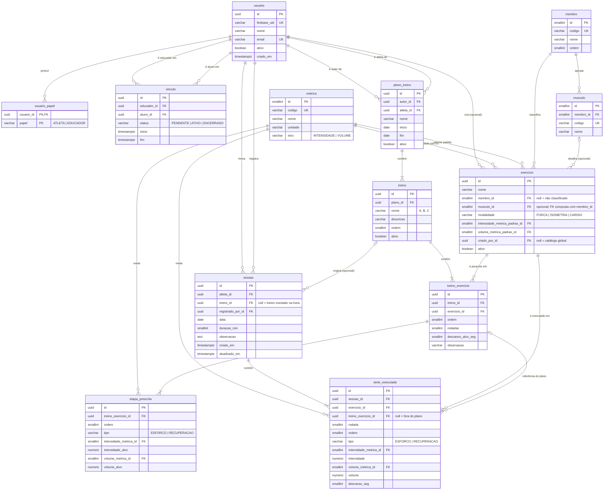

# MER: Modelo Entidade-Relacionamento

**Projeto:** Diário de Treino (nome provisório)
**Versão:** 1.0 (MVP de registro publicado; progresso e tela inicial no ar)
**Última atualização:** 14/10/2026
**Banco:** PostgreSQL
**Documentos relacionados:** [MAS.md](MAS.md), [BACKLOG.md](BACKLOG.md)

---

## 0. O que está aplicado no banco hoje

Esta seção separa o que **já existe no banco em produção** do que ainda é
**planejado** neste documento, para o MER não ser lido como se tudo estivesse
pronto.

**Aplicado (migrations na `main` e no Neon):**
- Tabelas: `usuario`, `usuario_papel`, `vinculo` (estrutura pronta, sem uso),
  `metrica` (seed dos 6 registros), `exercicio`, `plano_treino`, `treino`,
  `treino_exercicio`, `etapa_prescrita`, `rodada_marcador`, `sessao`,
  `serie_executada`.
- `exercicio` é classificado por **`membro_id`** (FK `membro`, obrigatório ao
  criar) e **`musculo_id`** opcional (FK composta `(musculo_id, membro_id)` →
  `musculo`) — ver 3.4.1, 3.4.2 e 3.5. O catálogo global tem **89 exercícios
  ativos** + 7 genéricos antigos inativos (`ativo=false`), carregados por
  seed/migration.
- Extensão `unaccent` habilitada (busca sem acento).

**PBI-31 / ADR-10 concluído.** Tabelas `membro` (8) e `musculo` (15) existem; o
antigo texto livre `grupo_muscular` foi **removido** (coluna dropada na etapa 4).

Migrations versionadas até aqui: `InitialCreate`, `HabilitaUnaccent`,
`CatalogoExerciciosCompleto` (carga dos 89 exercícios), `MembroMusculoEtapa1`
(cria `membro`/`musculo`, classifica o catálogo), `MembroMusculoEtapa4RemoveGrupo`
(remove `grupo_muscular`).

---

## 1. Convenções

- Tabelas e colunas em `snake_case`, no singular.
- Chave primária `id` do tipo `uuid` (gerada pela aplicação), exceto `metrica`, que é tabela de referência com `smallint`.
- Datas com hora em `timestamptz` (UTC); data do treino em `date`, porque o usuário informa o dia, não o instante.
- Enums guardados como `varchar` com `CHECK`, para leitura direta no banco e migração simples.
- Valores medidos em `numeric(9,2)`.
- Toda tabela de domínio tem `criado_em` e, quando editável, `atualizado_em`.
- Nada é apagado fisicamente se tiver histórico ligado: usa-se `ativo = false`.

## 2. Diagrama

> `membro` e `musculo` (e as FKs de `exercicio` para elas) **existem no banco**
> (PBI-31). O antigo campo livre `grupo_muscular` foi removido na etapa 4.

## 3. Dicionário de dados

### 3.1 `usuario`
Pessoa que usa o app. A identidade (senha, Google) fica no Firebase; aqui fica o vínculo com o domínio.

| Coluna | Tipo | Nulo | Regra |
|---|---|---|---|
| id | uuid | não | PK |
| firebase_uid | varchar(128) | não | Único. Liga o token ao usuário |
| nome | varchar(120) | não | |
| email | varchar(254) | não | Único, guardado em minúsculas |
| ativo | boolean | não | Padrão `true` |
| criado_em | timestamptz | não | Padrão `now()` |

### 3.2 `usuario_papel`
Papéis do usuário. Tabela separada porque uma pessoa pode ser atleta e educador ao mesmo tempo.

| Coluna | Tipo | Nulo | Regra |
|---|---|---|---|
| usuario_id | uuid | não | PK composta, FK `usuario` |
| papel | varchar(20) | não | PK composta. `CHECK (papel IN ('ATLETA','EDUCADOR'))` |

Todo usuário recebe `ATLETA` no primeiro acesso.

### 3.3 `vinculo` (estrutura pronta, uso futuro)
Relação entre educador e aluno. É a base da regra de acesso do educador.

| Coluna | Tipo | Nulo | Regra |
|---|---|---|---|
| id | uuid | não | PK |
| educador_id | uuid | não | FK `usuario`. Precisa ter papel `EDUCADOR` (validado na aplicação) |
| aluno_id | uuid | não | FK `usuario` |
| status | varchar(20) | não | `CHECK (status IN ('PENDENTE','ATIVO','ENCERRADO'))` |
| inicio | timestamptz | sim | Preenchido ao virar `ATIVO` |
| fim | timestamptz | sim | Preenchido ao virar `ENCERRADO` |

Restrições: `CHECK (educador_id <> aluno_id)`; índice único parcial em `(educador_id, aluno_id) WHERE status IN ('PENDENTE','ATIVO')`, para não existir dois vínculos abertos entre as mesmas pessoas.

### 3.4 `metrica`
Tabela de referência com o que pode ser medido. Nunca é texto livre, para os gráficos conseguirem agrupar.

| Coluna | Tipo | Nulo | Regra |
|---|---|---|---|
| id | smallint | não | PK |
| codigo | varchar(30) | não | Único, usado no código |
| nome | varchar(60) | não | Exibido na tela |
| unidade | varchar(20) | não | |
| eixo | varchar(20) | não | `CHECK (eixo IN ('INTENSIDADE','VOLUME'))` |

Carga inicial (seed via migration):

| id | codigo | nome | unidade | eixo |
|---|---|---|---|---|
| 1 | CARGA_KG | Carga | kg | INTENSIDADE |
| 2 | PESO_CORPORAL | Peso corporal | - | INTENSIDADE |
| 3 | ZONA | Zona | 1 a 5 | INTENSIDADE |
| 10 | REPETICOES | Repetições | rep | VOLUME |
| 11 | TEMPO_SEG | Tempo | s | VOLUME |
| 12 | DISTANCIA_M | Distância | m | VOLUME |

Os ids de intensidade e volume ficam em faixas separadas para facilitar leitura; novas métricas (escala de dor, amplitude) entram como novas linhas.

### 3.4.1 `membro` — APLICADO (PBI-31)
> ✅ **Existe no banco** (migration `MembroMusculoEtapa1`). O catálogo global já
> está classificado por membro. A coluna `grupo_muscular` foi **removida** na
> etapa 4 (`MembroMusculoEtapa4RemoveGrupo`); o membro é a classificação oficial.

Tabela de referência com os membros usados para filtrar e organizar exercícios. Substitui o antigo texto livre `grupo_muscular` (ADR-10 do MAS).

| Coluna | Tipo | Nulo | Regra |
|---|---|---|---|
| id | smallint | não | PK |
| codigo | varchar(30) | não | Único, usado no código |
| nome | varchar(40) | não | Exibido no chip de filtro |
| ordem | smallint | não | Ordem dos chips na tela |

Carga inicial (seed via migration):

| id | codigo | nome | ordem |
|---|---|---|---|
| 1 | PEITO | Peito | 1 |
| 2 | COSTAS | Costas | 2 |
| 3 | OMBROS | Ombros | 3 |
| 4 | BRACOS | Braços | 4 |
| 5 | PERNAS | Pernas | 5 |
| 6 | CORE | Core | 6 |
| 7 | CARDIO | Cardio | 7 |
| 8 | MOBILIDADE | Mobilidade | 8 |

`MOBILIDADE` cobre equilíbrio, alongamento e exercícios de reabilitação que não miram um músculo. Lista sujeita à validação do Vinicius; ajustes entram por migration de seed.

### 3.4.2 `musculo` — APLICADO (PBI-31 etapa 1)
> ✅ **Existe no banco** (migration `MembroMusculoEtapa1`), com 15 músculos. A
> restrição única `(id, membro_id)` é a `AK_musculo_id_membro_id`, alvo da FK
> composta de `exercicio`.

Detalhe opcional dentro de cada membro. Hoje serve para o cadastro mais preciso; no futuro, para contar séries por músculo.

| Coluna | Tipo | Nulo | Regra |
|---|---|---|---|
| id | smallint | não | PK |
| membro_id | smallint | não | FK `membro` |
| codigo | varchar(30) | não | Único |
| nome | varchar(40) | não | |

Restrição única em `(id, membro_id)` para servir de alvo da FK composta de `exercicio`.

Carga inicial:

| Membro | Músculos |
|---|---|
| Peito | Peitoral |
| Costas | Dorsal, Trapézio |
| Ombros | Deltoide |
| Braços | Bíceps, Tríceps, Antebraço |
| Pernas | Quadríceps, Posteriores de coxa, Glúteos, Panturrilha, Adutores |
| Core | Abdômen, Oblíquos, Lombar |
| Cardio | (nenhum) |
| Mobilidade | (nenhum) |

### 3.5 `exercicio`
Catálogo de exercícios. Global (`criado_por_id` nulo) ou próprio do usuário.

**Esquema atual no banco (hoje):**

| Coluna | Tipo | Nulo | Regra |
|---|---|---|---|
| id | uuid | não | PK |
| nome | varchar(80) | não | |
| membro_id | smallint | sim | FK `membro`. Obrigatório ao criar um exercício; nulo só nos globais ainda não classificados (ex.: "Levantamento terra") |
| musculo_id | smallint | sim | Opcional. FK composta `(musculo_id, membro_id)` → `musculo(id, membro_id)`, garante que o músculo pertence ao membro |
| modalidade | varchar(20) | não | `CHECK (modalidade IN ('FORCA','ISOMETRIA','CARDIO'))`. Define qual gráfico de progresso usar |
| intensidade_metrica_padrao_id | smallint | não | FK `metrica`, eixo `INTENSIDADE` |
| volume_metrica_padrao_id | smallint | não | FK `metrica`, eixo `VOLUME` |
| criado_por_id | uuid | sim | FK `usuario` (`ON DELETE CASCADE`). Nulo = catálogo global |
| ativo | boolean | não | Padrão `true`. Exercício com histórico é arquivado, nunca apagado |

Índice único em `(lower(nome), coalesce(criado_por_id, '00000000-0000-0000-0000-000000000000'))` para evitar duplicata no mesmo catálogo.

Exemplos de padrão (forma de medir = par de métricas): força comum = carga ×
repetições; força com peso corporal (flexão, barra fixa) = peso corporal ×
repetições; isometria (prancha) = peso corporal × tempo; cardio (corrida) =
zona × tempo.

**Catálogo global carregado (migration `CatalogoExerciciosCompleto`):** 89
exercícios ativos cobrindo peito, costas, ombros, braços, pernas, core, cardio e
mobilidade, já classificados por `membro_id`/`musculo_id`. Mais 7 genéricos
antigos do seed original mantidos como **inativos** (`ativo=false`) para não
quebrar histórico já ligado (FKs `Restrict`); eles somem do catálogo pelo
filtro `Ativo`.

> **APLICADO (PBI-31 / ADR-10, concluído):** `grupo_muscular` foi substituído
> por `membro_id` (FK `membro`, obrigatório na criação) e `musculo_id` (FK
> composta `(musculo_id, membro_id)` → `musculo`). A etapa 1 criou as tabelas e
> converteu os dados; a etapa 4 (`MembroMusculoEtapa4RemoveGrupo`) **removeu a
> coluna `grupo_muscular`**.
>
> **Modalidade e membro são coisas diferentes.** A modalidade define como o
> exercício é medido e qual gráfico usar (estrutural); o membro é classificação
> para filtrar. Um não substitui o outro.

### 3.6 `plano_treino`
Conjunto de fichas de um atleta. No MVP, autor e atleta são a mesma pessoa.

| Coluna | Tipo | Nulo | Regra |
|---|---|---|---|
| id | uuid | não | PK |
| autor_id | uuid | não | FK `usuario`. Quem montou (atleta ou educador) |
| atleta_id | uuid | não | FK `usuario`. Quem executa |
| nome | varchar(80) | não | |
| inicio | date | não | |
| fim | date | sim | |
| ativo | boolean | não | Padrão `true` |

Índice único parcial em `(atleta_id) WHERE ativo`: um plano ativo por atleta.

### 3.7 `treino`
Ficha (A, B, C) dentro do plano.

| Coluna | Tipo | Nulo | Regra |
|---|---|---|---|
| id | uuid | não | PK |
| plano_id | uuid | não | FK `plano_treino` |
| nome | varchar(40) | não | Ex.: "A" |
| descricao | varchar(80) | sim | Ex.: "Peito e tríceps" |
| ordem | smallint | não | Define a sequência sugerida na tela inicial |
| ativo | boolean | não | Padrão `true` |

### 3.8 `treino_exercicio`
Exercício prescrito numa ficha.

| Coluna | Tipo | Nulo | Regra |
|---|---|---|---|
| id | uuid | não | PK |
| treino_id | uuid | não | FK `treino`, `ON DELETE CASCADE` |
| exercicio_id | uuid | não | FK `exercicio` |
| ordem | smallint | não | |
| rodadas | smallint | não | Séries na musculação, repetições do bloco no intervalado. `CHECK (rodadas > 0)` |
| descanso_alvo_seg | smallint | sim | Descanso entre rodadas |
| observacao | varchar(200) | sim | Instrução livre do prescritor |

### 3.9 `etapa_prescrita`
Etapas de cada rodada. Musculação tem uma etapa; intervalado tem esforço e recuperação.

| Coluna | Tipo | Nulo | Regra |
|---|---|---|---|
| id | uuid | não | PK |
| treino_exercicio_id | uuid | não | FK `treino_exercicio`, `ON DELETE CASCADE` |
| ordem | smallint | não | Ordem dentro da rodada |
| tipo | varchar(20) | não | `CHECK (tipo IN ('ESFORCO','RECUPERACAO'))` |
| intensidade_metrica_id | smallint | não | FK `metrica` |
| intensidade_alvo | numeric(9,2) | sim | Nulo = livre |
| volume_metrica_id | smallint | não | FK `metrica` |
| volume_alvo | numeric(9,2) | sim | |

Exemplo: 5 tiros = `rodadas = 5` com etapas (ESFORCO, zona 4, 90 s) e (RECUPERACAO, zona 2, 90 s). Supino 3 x 10 = `rodadas = 3` com uma etapa (ESFORCO, carga 30 kg, 10 repetições).

### 3.10 `sessao`
Um treino realizado em uma data.

| Coluna | Tipo | Nulo | Regra |
|---|---|---|---|
| id | uuid | não | PK |
| atleta_id | uuid | não | FK `usuario` |
| treino_id | uuid | sim | FK `treino`. Nulo = sessão montada na hora |
| registrado_por_id | uuid | não | FK `usuario`. Hoje é o próprio atleta; guarda quem lançou para auditoria futura |
| data | date | não | Data em que o treino aconteceu, não a do lançamento. `CHECK (data <= current_date + 1)` |
| duracao_min | smallint | sim | |
| observacao | text | sim | Pode conter dado de saúde: não vai para log |
| criado_em | timestamptz | não | |
| atualizado_em | timestamptz | não | |

A modalidade da sessão (musculação, cardio) é derivada dos exercícios das séries, sem coluna própria.

### 3.11 `serie_executada`
O que de fato aconteceu, série por série.

| Coluna | Tipo | Nulo | Regra |
|---|---|---|---|
| id | uuid | não | PK |
| sessao_id | uuid | não | FK `sessao`, `ON DELETE CASCADE` |
| exercicio_id | uuid | não | FK `exercicio` |
| treino_exercicio_id | uuid | sim | FK `treino_exercicio`, `ON DELETE SET NULL`. Liga ao prescrito para comparação |
| rodada | smallint | não | 1, 2, 3... |
| ordem | smallint | não | Ordem da etapa dentro da rodada (1 na musculação) |
| tipo | varchar(20) | não | `ESFORCO` ou `RECUPERACAO` |
| intensidade_metrica_id | smallint | não | FK `metrica`, eixo `INTENSIDADE` |
| intensidade | numeric(9,2) | sim | Nulo quando a métrica é peso corporal |
| volume_metrica_id | smallint | não | FK `metrica`, eixo `VOLUME` |
| volume | numeric(9,2) | não | `CHECK (volume >= 0)` |
| descanso_seg | smallint | sim | |
| marcador | varchar(20) | não | Tag da série (TV-1). `DEFAULT 'VALIDA'`, `CHECK` com os 10 códigos. Só identificação — não entra em cálculo |

### 3.12 `rodada_marcador`

Tag (marcador) prescrita por rodada de um exercício da ficha (TV-1). A tag é de
uma série específica, por isso não cabe em `etapa_prescrita` (que é o molde de
todas as séries). Só existe linha para rodada com tag ≠ `VALIDA`; rodada sem
linha vale `VALIDA`.

| Coluna | Tipo | Nulo | Regra |
|---|---|---|---|
| treino_exercicio_id | uuid | não | PK composta + FK `treino_exercicio`, `ON DELETE CASCADE` |
| rodada | smallint | não | PK composta. `CHECK (rodada >= 1)` |
| marcador | varchar(20) | não | `CHECK` com os 10 códigos |

Lista fixa dos 10 marcadores (aprovada pelo PO, 15/10): `VALIDA`, `AQUECIMENTO`,
`PREPARATORIA`, `TOP_SET`, `BACK_OFF`, `FALHA`, `DROP_SET`, `REST_PAUSE`,
`NEGATIVA`, `PARCIAIS`. Enum numa fonte só no domínio; o `CHECK` deriva dele.

## 4. Índices de consulta

| Índice | Atende |
|---|---|
| `sessao (atleta_id, data DESC)` | Sessões do período, tela inicial, progresso |
| `serie_executada (sessao_id)` | Detalhe da sessão |
| `serie_executada (exercicio_id, sessao_id)` | Última execução do exercício (pré-preenchimento) e evolução por exercício |
| `exercicio (lower(nome), coalesce(criado_por_id, uuid-zero))` único | Impede nome duplicado no mesmo catálogo |
| `exercicio (membro_id)` *(planejado, PBI-31)* | Filtro por membro no seletor e no catálogo |
| `treino (plano_id, ordem)` | Fichas do plano |
| `treino_exercicio (treino_id, ordem)` | Exercícios da ficha |
| `vinculo (aluno_id) WHERE status = 'ATIVO'` | Regra de acesso do educador |

## 5. Regras de negócio que dependem do modelo

1. **Pré-preenchimento:** ao abrir a ficha X para registrar, cada exercício recebe as séries da sessão mais recente do mesmo atleta que contenha aquele exercício. Sem histórico, usa os alvos de `etapa_prescrita`.
2. **Evolução de força (implementado, PBI-20):** por sessão, a série de esforço de **maior carga** (`intensidade`), com o `volume` (repetições) **daquela** série — desempate por maior volume. Decisão do PO (14/10): usa a maior carga, não o volume total, e cada ponto mostra as reps feitas com aquela carga.
3. **Evolução de isometria (implementado, PBI-20):** maior `volume` (tempo) por sessão.
4. **Evolução de cardio:** tempo total por zona no período. *(Incremento 2, ainda não implementado.)*
5. **Observação no gráfico (implementado, PBI-21):** cada `PontoProgresso` carrega `sessao.observacao` e o `sessaoId`; pontos com observação são destacados e abrem a nota do dia + link para o detalhe da sessão.
6. **Acesso:** toda consulta filtra por `atleta_id` após passar pela regra de controle de acesso do MAS (seção 11.3).
7. **Integridade de métrica:** a métrica gravada na série precisa pertencer ao eixo correto (validado na aplicação, porque `CHECK` não consulta outra tabela).
8. **Tag de série (TV-1):** `serie_executada.marcador` e `rodada_marcador` só identificam "como" a série foi feita. **Não** entram em nenhum cálculo — o gráfico de progresso (regras 2 e 3) continua por `tipo = ESFORCO` e maior carga/tempo, independente da tag. Pré-preenchimento da tag no registro: tag da ficha para a rodada; sem ficha, tag da última sessão daquele exercício; sem nenhuma, `VALIDA`.

## 6. Exemplo de dados

Uma sessão do Treino A com supino em 2 séries e uma prancha:

| tabela | valores |
|---|---|
| sessao | data 2026-09-29, treino A, observacao "Dormi mal" |
| serie_executada | supino, rodada 1, ESFORCO, CARGA_KG 30, REPETICOES 10, descanso 90 |
| serie_executada | supino, rodada 2, ESFORCO, CARGA_KG 35, REPETICOES 8, descanso 90 |
| serie_executada | prancha, rodada 1, ESFORCO, PESO_CORPORAL nulo, TEMPO_SEG 45 |

## 7. Previsto para incrementos futuros

- **Músculos secundários e volume por músculo:** tabela `exercicio_musculo_secundario (exercicio_id, musculo_id)` e contagem de séries por semana (1 para o músculo principal, 0,5 para os secundários).

- **Tags da observação:** tabela `tag` e `sessao_tag` para cruzar padrões (sono ruim, dor). Não entra no MVP.
- **Faixas de zona por atleta:** tabela `zona_atleta (atleta_id, zona, fc_min, fc_max)` se a zona for definida por frequência cardíaca. Depende da resposta do Vinicius.
- **Importação de treino:** coluna `origem` em `sessao` (MANUAL, ARQUIVO) quando houver importação do relógio.
- **Consentimento:** tabela `consentimento (usuario_id, versao_termo, aceito_em)` antes do modo educador.
